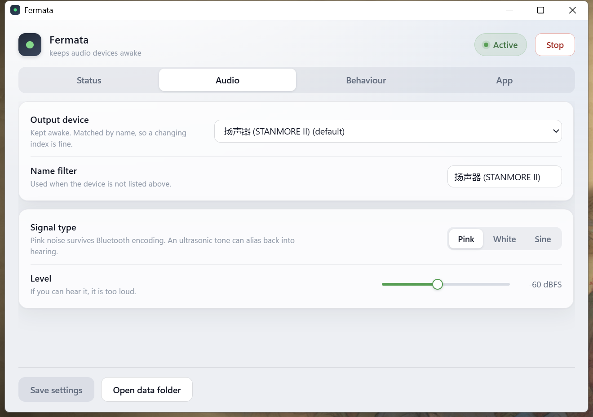
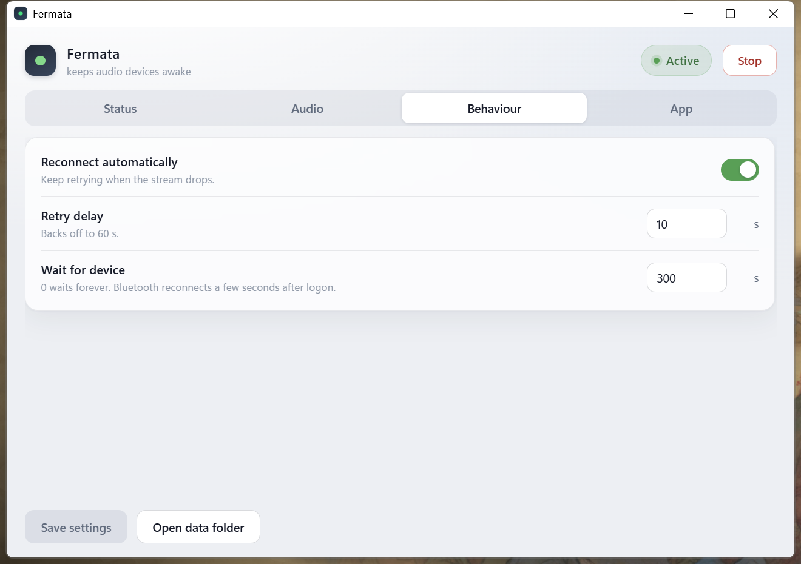
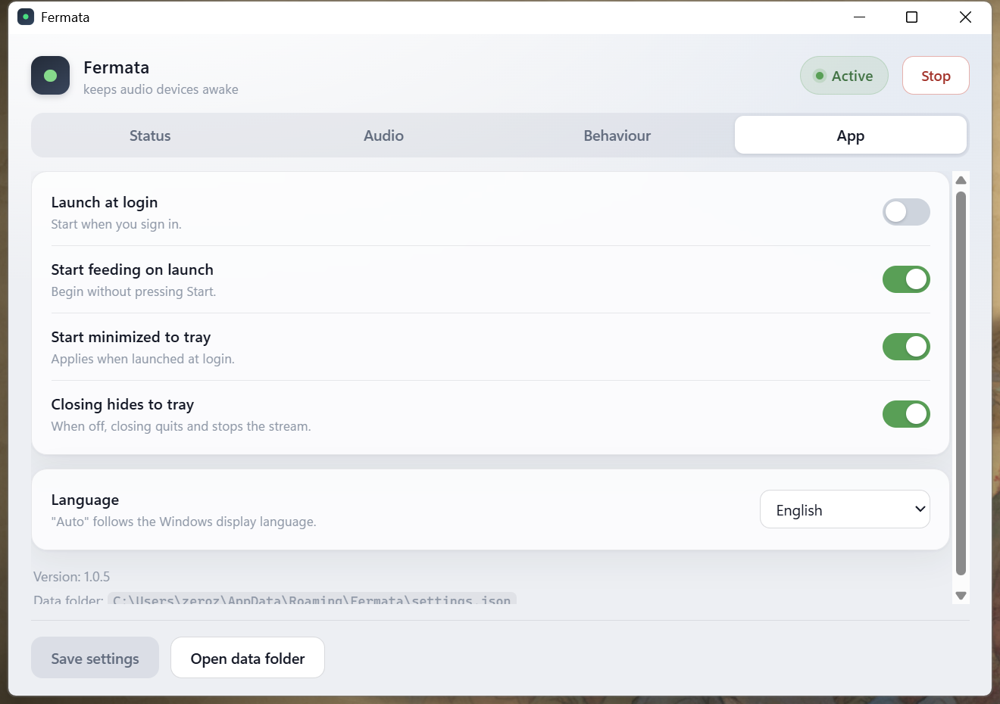

# Fermata

Keeps audio devices out of standby with a signal you cannot hear.

**English** · [简体中文](README.zh-CN.md)

Fermata is a small Windows tray application. It feeds your speaker, DAC, or
Bluetooth receiver a continuous inaudible signal, so the device never decides it
has been idle long enough to power down.

> **Why the name?** A *fermata* is the musical symbol that tells a performer to
> hold a note longer than its written value. That is exactly the trick: hold the
> signal, so the device never sees silence.

---

## Screenshots

Fermata 1.0.5 running on Windows 11, feeding a Marshall Stanmore II. The UI is
shown in English here; it also ships with a Simplified Chinese translation,
switchable under **App → Language**.


| Audio | Behaviour | App |
| :---: | :---: | :---: |
|  |  |  |

---

## The problem

Plenty of audio hardware shuts itself off after a stretch of silence: Bluetooth
speakers drop the link, USB DACs sleep and pop when they wake, soundbars switch
inputs. Many of these timers cannot be disabled at all.

The Marshall Stanmore II is one such case: it enters standby after **20 minutes
without input** -- an official specification, not a rule of thumb (see
[Marshall support](https://www.marshall.com/hk/en/support/speakers/support-for-stanmore-ii-bluetooth/how-to-put-in-standby-mode)
and the [STANMORE II user manual](https://www.marshallheadphones.com/on/demandware.static/-/Library-Sites-SharedLibrary-Marshall/default/dwe0dadd06/images/cms-pages/user/Stanmore_II_Full_User_Manual_en_230706.pdf);
in standby all indicators go dark and a top-panel control or the Marshall
Bluetooth app is needed to wake it). Neither the knobs nor the app expose a
setting to disable that timer. Fermata was written for that speaker, but nothing
in it is specific to it.

## Why noise, and not an ultrasonic tone

The obvious fix -- play a 20 kHz tone nobody can hear -- fails in practice. This
is the part quick scripts tend to get wrong:

| Approach | What actually happens |
|---|---|
| **20 kHz sine** | Sits at the edge of hearing, and Bluetooth codecs (SBC / aptX) fold content near Nyquist back **into the audible band** as a piercing whistle |
| **5-20 Hz sine** | A high-pass filter in the codec strips it before it ever reaches the amplifier |
| **Digital silence** | Some devices judge standby on silence itself, so this accomplishes nothing |
| **Broadband noise** (what Fermata uses) | However much the codec and the device's own crossovers remove, some band always carries energy, so the device always sees signal |

The default is **pink noise at -60 dBFS**: inaudible in any real room, yet far
above the amplifier's own noise floor.

### How the noise is made

Pink noise, as a **ten-second loop**: random-phase spectral frames, each shaped by
`1/sqrt(f)`, inverse transformed, and overlap-added *circularly* — so the loop is
periodic by construction and has no seam to hear. At runtime the callback only
slices it; the level is baked in, so there is no arithmetic at all.

That last part is the whole point. The signal path used to generate a fresh frame
per callback, which measured **0.45% of a core** on a live stream (in-callback
timing, Stanmore II over WASAPI: ~95% of the callback's cost was generation and
almost none of it was the writing or the level maths). Slicing a precomputed loop
measures **0.02%**. Tests measure the tilt (-3 dB/octave), the level, that the
loop repeats exactly one period later, and that the wrap step is *smaller than
the largest sample-to-sample step already present in the signal* — which is what
"no seam" means in practice rather than as an assertion.

The level is exact rather than approximate for two small reasons: the sine window
is used, not Hann, because at a 50% hop the sum of its squares is identically 1
while Hann's wobbles between 0.5 and 1; and the spectral mask is scaled by
Parseval so a unit-normal random spectrum really does come out at unit variance.

An earlier version of this used Paul Kellet's one-pole filter bank, evaluated one
sample at a time in Python — 44 100 interpreter iterations a second, **9.4% of a
core** for a utility whose entire job is to be invisible. That is where this
started.

## Cost

Two things turned out to be true, and neither was obvious beforehand.

**The audio is not the expensive part, and no longer close to it.** Measured on
the author's machine (i7-11700K, 16 threads, Windows 11) as process CPU time over
45-60 second windows:

| What | Measured |
|---|---|
| CPU, audio engine alone (no GUI) | **0.08-0.10%** of one core (1.0.4 halves the callback rate, see below) |
| CPU, whole app, tray only | **0.9%** of one core (app 0.24% + WebView2 0.66%) |
| CPU, whole app, window open | **~3%** of one core (app 0.4% + WebView2 2.8%) |

Read the second and third rows together: having the settings window on screen
costs around **2% of a core more** than leaving it in the tray, and the largest
single line items in the whole program live there -- WebView2's browser process
(~1.0%), renderer (~0.9%) and GPU process (~0.9%), the last of which is drawing a
static page. Hide the window and the renderer and GPU both drop to 0.00%. The
audio engine, for comparison, is 0.1%.

That is the price of a WebView2 settings window, and it is worth knowing before
deciding what you want: this is a tray icon that occasionally opens a form.

| What | Measured |
|---|---|
| Memory, tray state | ~500 MB working set — **~130 MB** for the app, **~370 MB** for its seven WebView2 host processes |
| Memory, app process commits | ~570 MB (the .NET runtime reserves address space; only ~130 MB of it is resident) |

Working set is not a fixed property. Windows trims an idle process hard under
memory pressure, and this one was observed at **140 MB total** on the same
machine an hour later, with no code change. Task Manager will show you whatever
the current situation is; ~500 MB is what it settles at when nothing is asking
for memory.

The honest summary of this table: **the settings window, not the signal, is what
this costs.** If that trade is wrong for you, a command-line C++ tool is a tenth
of it — see the comparison further down.

### 1.0.4: the only lever left is callback frequency

Timing the callback body alone at 16384 frames: our own code takes **9.7 us**
(0.22 us slicing, 8.67 us writing both channels, 1.3 us RMS every second
block) — **0.0026% of a core** — while the whole engine costs about 0.10%. The
arithmetic is not the cost; **PortAudio's per-callback scheduling** is. The only
remaining lever is how often it runs.

Real engine on a spare, non-Bluetooth WASAPI endpoint (48 kHz), two independent
measurements:

| Block frames | Callbacks / 20 s | Relative CPU (cycle-counted, idle-subtracted) | 60 s process CPU |
|---|---|---|---|
| 16384 (before) | 73 | 100% | 0.104% |
| **32768 (now)** | **37** | **65.0%** | **0.078%** |
| 65536 | 19 | 40.7% | 0.026% * |

\* 0.026% is exactly **one** 15.6 ms Windows CPU-accounting tick, so it sits at
the resolution limit: read it as "clearly lower", not as an exact value. The
cycle counter has no such quantisation and is the ratio to trust. These absolute
numbers come from a different endpoint, so **do not compare them row-for-row
with the table above**; what is meaningful is the ratio within one measurement.

**65536 was not chosen.** At 44.1 kHz one block lasts 1.49 s, so the 1.5 s
fade-out spans three callbacks, a stop can take ~4.5 s (near the 6 s join
timeout), and the 5 s watchdog would see only 3.4 callback intervals. It was
not verified on a Bluetooth endpoint. Halving the callback rate takes most of
the gain while keeping stops near 3 s. The heartbeat also moved from 0.5 s to
1 s: the window refreshes once a second anyway, and the extra wake-up only
pulls the CPU out of a deep C-state.

**Keep the scale in mind:** the engine was already ~0.1% of a core, and most of
the ~0.9% tray total is WebView2. This pass saves 0.02-0.03% of a core and half
the timer wake-ups. It does not change the table above; it changes how often
this background process bothers the CPU at all.

---

## Quick start

Download **[the latest release](https://github.com/zaxchou/fermata/releases/latest)**
and extract the zip, or [build it yourself](#building-from-source).

Then run `Fermata.exe`.

First launch opens the settings window and starts feeding the device right away.
After that:

- **Closing the window keeps it running.** It lives in the tray; use *Quit* in
  the tray menu to actually exit.
- The **tray icon's dot colour is the status**: green = feeding, amber =
  waiting or reconnecting, red = error, grey = stopped. The dark rounded square
  around it is the same mark you see in the window header.
- Tick **Launch at login** and it starts by itself, minimized to the tray.
- **Save settings** stays grey while nothing has changed (the footer reads
  *No unsaved changes*). It turns green as soon as an edit is pending, and goes
  grey again after saving -- or if you put the value back by hand. A failed
  save keeps your edits and the green button, so you can retry.

It is a folder build, so move the whole folder. The EXE needs its `_internal`
sibling; copying the EXE alone will not work.

---

## Settings

| Setting | What it does |
|---|---|
| **Output device** | Which device to keep awake, chosen by name from the list. *Any device (system default)* resolves to whatever the default output is at that moment -- see the note below. |
| **Name filter** | Used instead, when the device is not in the list -- for example before a Bluetooth speaker has been paired. Case-insensitive substring match; plain text, not a pattern. |
| **Signal type** | Pink (default), white, or sine. Pink is the safe choice -- see above. |
| **Frequency** | Only used by the sine signal. |
| **Level** | -90 to -20 dBFS. **If you can hear it, it is too loud.** |
| **Reconnect automatically** | Keep retrying if the stream drops: device switched off, out of range, and so on. |
| **Retry delay** | Base seconds between retries, backing off to a 60 s maximum. A stream that ran healthily for a minute resets it. |
| **Wait for device** | How long to wait at startup for the device to appear. `0` waits forever. Bluetooth usually reconnects a few seconds after logon. |
| **Launch at login** | Writes the per-user Run key, pointing at the EXE. |
| **Start feeding on launch** | Begin as soon as the app starts, without pressing Start. |
| **Start minimized to tray** | Only applies when launched at login. |
| **Closing hides to tray** | Turn this off and the window's X quits the app and stops the stream. |
| **Language** | *Auto (system)* follows the Windows display language; or pin English / 简体中文. Applies immediately, including the tray menu, without a restart. |

On the level setting: it sets the **peak amplitude** of the generated waveform,
not its RMS. Pink and white therefore share the same RMS (both normalised to
uniform white noise) at 4.8 dB below the nominal figure, while a sine is 1.8 dB
louder in RMS terms. A nominal `-60 dBFS` is `-64.8 dBFS` RMS. The status tab
shows the measured RMS, so you can see what is actually going out.

Measured on a Stanmore II with a WASAPI loopback capture, the continuous floor
arrives at the endpoint at **-62.3 dBFS RMS / -49.8 dBFS peak**, with the
session at 100% and unmuted. The signal does arrive; it is simply very quiet,
which is what the next section addresses.

On the device setting: *Any device (system default)* is resolved **when the
stream starts**, and again on each reconnect -- not continuously. Switching the
Windows default output afterwards does not move the stream. That is deliberate:
if it chased the default, plugging in headphones would abandon the speaker this
tool exists to protect. The consequence worth knowing is that the device a
running instance feeds is decided at startup, so **if you want one specific
device protected, select it by name rather than leaving it on "Any device"**.
Device indices shift between launches (a Bluetooth endpoint that was `#10` can be
`#14` an hour later), which is why the selection is stored as a name.

### Files

| Path | |
|---|---|
| `%APPDATA%\Fermata\settings.json` | Settings. Hand-editable; unknown keys are ignored and out-of-range values are clamped. |
| `%APPDATA%\Fermata\logs\app.log` | Log. Append-only. |
| `%APPDATA%\Fermata\selftest.txt` | Report from the last `--selftest`. |

Set `FERMATA_DATA_DIR` to move all of that somewhere else -- useful for a
portable install on a USB stick, and used by the tests to avoid touching a real
profile.

There is also a `sample_rate` setting that has no UI control (default `0` = use
the device's own rate). Edit it by hand if you need to pin one.

---

## Verifying it works

Fermata ships with a headless check that exercises the real stack: bundled
assets, settings, device enumeration, the autostart command, and an actual audio
stream.

```powershell
.\Fermata.exe --selftest
```

It prints a pass/fail list, writes a report to the data folder, and exits `0`
only if everything passed. That is the point of it: you can confirm the product
works on your machine without opening the window and guessing.

To confirm the device really stays awake: run the app, leave the volume at a
normal level, wait past the device's idle timeout, and check its indicator light
or connection state. **This step cannot be skipped.** `--selftest` proves the
signal reached the endpoint; it cannot prove the speaker's standby circuit
accepted it.

---

## Standby pulse (added in 1.0.4, off by default since 1.0.5)

Feeding only an inaudible floor rested on an untested assumption: does a device
judge idleness by the *presence of a stream*, or by the *level of the decoded
audio*? If that threshold sits above the floor, the UI stays green and the frame
count keeps climbing while the speaker still goes to sleep after 20 minutes --
the worst form of a feature that only looks like it works. 1.0.4 therefore added
a switchable periodic pulse: on top of the unchanged floor, a 0.35 s, -32 dBFS,
90 Hz tone every 120 seconds (90 Hz sits roughly 25 dB down on the
equal-loudness curve relative to 1 kHz; a 30 ms cosine ramp prevents a click).
Loopback capture confirmed the peak rises from **-49 dBFS to -29 dBFS**
(+20 dB) during a pulse, with accurate periodicity.

**A 2026-11-04 measurement falsified that hypothesis on this machine.** The
build under test was the 8 October one: plain -60 dBFS pink noise, **no pulse
and no watchdog**. A Marshall Stanmore II over Bluetooth A2DP stayed up through
**47 m 55 s** of silence: endpoint Active for 2875/2875 s, `A2DP SNK` present
throughout, Fermata absent for 0 s, zero monitoring gaps; all ten 5-minute
segments were FLOOR with no silent second; past the 20-minute mark the user
confirmed the speaker was still on. In short, **the -49 dBFS floor alone is
enough here** and the pulse is not needed.

1.0.5 therefore changes `keepalive_pulse` to default `false`. The pulse stays
as an option for devices with a genuinely higher level gate.

**The released 1.0.5 build was then verified the same way (2026-11-04).** On
the same speaker it held **47 m 26 s of continuous silence** (20:21:16 to
21:08:42; 2819 one-second samples = 46 m 59 s by record count) -- **2.37x** the
official 20-minute timer. Every second was FLOOR at a median peak of -49.7
dBFS; Fermata absent 0 s, `A2DP SNK` missing 0 s, endpoint non-Active 0 s,
monitoring gaps 0. The window ended because the user played audio to check:
playback worked **with no button press and no app**, and the user confirmed the
speaker had stayed awake. Since Marshall says a standby speaker must be woken
by a top-panel control or the app, that direct playback is stronger evidence
than Bluetooth PnP presence alone. It matches the old build's 47 m 55 s within
56 seconds.

So the attribution stays narrow: 1.0.5 improves performance and observability
(halved callback rate, stall watchdog, status readouts), **not** keepalive
strength. The plain -60 dBFS floor did the work in both runs; the pulse stayed
off (0 pulse seconds) and neither the watchdog nor reconnect ever fired.

> **Boundary**: one speaker, one long window per build -- this does not
> generalise. No software here can read the standby circuit; the strongest
> local evidence is audio playing straight after ~47 minutes of silence with
> no wake-up action, backed by Bluetooth PnP presence and direct user
> observation. The pulse has never been shown to help, so it should not ship
> enabled.

| Key | Default | Meaning |
|---|---|---|
| `keepalive_pulse` | `false` | Master switch; set `true` to enable (off by default, see above) |
| `pulse_interval_s` | `120` | Period, well under the device's idle timeout (Stanmore II: 1200 s) |
| `pulse_duration_s` | `0.35` | Length of one burst |
| `pulse_level_dbfs` | `-32` | Peak level, clamped to -70 .. -20 dBFS |
| `pulse_freq_hz` | `90` | Low tone, clamped to 30 .. 500 Hz |

Restart Fermata after editing `settings.json` (the burst is built when the
stream opens). The status tab gained two readouts: **Last output** (how long
since the last block actually moved, which exposes a green UI on a dead stream)
and **Standby pulse** (On/Off).

### A 20-minute A/B test (only if your speaker still sleeps)

1. Power the speaker on, select Bluetooth as its source, play no music or video,
   and leave the Windows volume at its normal level.
2. **Leave the default** (`keepalive_pulse: false`), wait **22 minutes**, and
   look at the indicator lights (all off in standby). On the reference machine
   this passed twice: 47 m 55 s on the old build and 47 m 26 s on 1.0.5, both
   past the official 20-minute timer.
3. Only if step 2 really slept, set `keepalive_pulse: true`, restart Fermata,
   and wait another **22 minutes**.
4. If only step 3 stays awake, the pulse works. If **both** sleep, the level is
   not the cause: check the speaker's selected source, whether a second paired
   Bluetooth device took over as the active source, the absolute volume on both
   ends, and whether Fermata is still running in the tray at all.
5. If you can hear the pulse, lower `pulse_level_dbfs` by 5 dB and retest to
   find the quietest level that still works.

1.0.4 also adds a **stall watchdog**: if the frame counter stops advancing for
5 seconds the stream is declared dead and rebuilt, and the endpoint is
re-validated every 10 seconds. Previously a Bluetooth link that dropped without
raising left the UI showing "running" indefinitely.

---

## How this compares to similar tools

This space is not empty, and some existing tools are more mature than this one.
Being upfront about that:

| Project | Notes |
|---|---|
| [vrubleg/soundkeeper](https://github.com/vrubleg/soundkeeper) | C++, Windows, no GUI, very configurable, including its own noise modes. The most established option if you want no interface at all. |
| [Deimz/SoundKeeper](https://github.com/Deimz/SoundKeeper) | Python, tray-only, configured by editing the source. |
| [Carve/audio-keep-alive](https://github.com/Carve/audio-keep-alive) | Go, cross-platform tray. |
| **Fermata** | Windows, settings GUI plus tray, autostart, reconnect, and a built-in `--selftest`. Its distinguishing feature is that the signal choice and the failure modes above are documented and testable rather than assumed. |

If a command-line-only C++ tool suits you better, `vrubleg/soundkeeper` is
probably what you want.

---

## Building from source

```
pip install -r requirements.txt

pyinstaller --noconfirm --clean Fermata.spec
# -> dist\Fermata\
```

Python 3.11 or newer. On Windows the settings window uses the WebView2 runtime;
it ships with Windows 11 and with current Windows 10 builds, and otherwise
installs from Microsoft as a small standalone package.

Run without packaging:

```
python app\main.py
python app\main.py --minimized     # tray only, as launch-at-login does
python app\main.py --selftest      # headless check
```

### Tests

Three suites, each isolated to a throwaway data directory, and all of them exit
non-zero on failure. Two caveats: the GUI and EXE suites stop any running
Fermata first (the single-instance guard would otherwise refuse the instance
under test), and the EXE suite puts your Run key back the way it found it.

```
python tests\test_core.py    # 65 checks: settings, autostart, devices, signal
                             # spectrum, loop periodicity and level, pulse,
                             # cross-block fades, engine lifecycle
python tests\test_gui.py     #  9 checks: window, tray, log, single-instance
python tests\test_exe.py     # 15 checks: packaged EXE acceptance
```

**Do not run the tests blindly while the default output is being measured.**
The lifecycle check in `test_core.py` and the packaged `--selftest` use the
system default output by default, which opens a *second* stream on the same
speaker, raises its level and invalidates whatever is being measured. Point
them at a spare endpoint instead (a case-insensitive substring of its name):

```
set FERMATA_TEST_DEVICE_HINT=KKL
python tests\test_core.py
Fermata.exe --selftest
```

`test_gui.py` and `test_exe.py` **stop every running Fermata** first (the
single-instance guard requires it), so do not run those while the app is
protecting a speaker.

`test_exe.py` needs a build; it runs the EXE's own `--selftest`, launches the
GUI, sends a real `WM_CLOSE` to the window to prove that clicking the X hides to
the tray instead of killing the app, and confirms the Run key is repointed at the
packaged EXE.

`test_core.py` asserts the signal itself: the pink spectrum is measured and must
land between -1.5 and -4.5 dB/octave, its RMS must match uniform white, and the
level coming out of a live stream must match the dBFS setting.

---

## A packaging bug worth knowing about

If you build a pywebview + sounddevice app with PyInstaller, you may hit this.

The packaged EXE failed to open the audio stream with

```
PortAudioError: Unanticipated host error [PaErrorCode -9999]
WdmSyncIoctl: DeviceIoControl GLE = 0x00000492
```

while the identical source run worked fine. The cause: **PortAudio's WASAPI
backend requires COM to be initialized on the thread that opens the stream.**
Fermata streams from a worker thread, which has no COM apartment of its own. The
frozen build was strict about it; the source run happened to get away with it,
which is the worst possible shape for a bug, because it appears only after
packaging.

`app/core/engine.py` calls `CoInitializeEx(COINIT_MULTITHREADED)` on the worker
thread before touching PortAudio. Without it, the packaged app streams nothing.

---

## Limits

- **Windows only.** The COM initialization and the Run-key autostart are both
  Windows-specific, and the tests assume Windows.
- **The app has to actually be running.** With launch-at-login off, a reboot or
  a sleep/wake cycle does not bring Fermata back, and the device will go to
  standby during that gap. Whether it should be resident is your call; the app
  will not change that setting behind your back. Every launch writes
  `window created` to `%APPDATA%\Fermata\logs\app.log`, which is the easiest way
  to check.
- **Keep the volume at a normal level.** Most amplifiers decide standby before
  the volume control, but this is not universally documented, so a volume knob at
  zero is untested territory.
- **Devices must already be paired.** Fermata waits for an endpoint to appear; it
  does not pair Bluetooth devices for you.
- **Bluetooth reconnection is at the mercy of the OS.** Fermata waits and
  retries, but it cannot force a link the Bluetooth stack refuses to make.

---

## Not affiliated with Marshall

Marshall and Stanmore are trademarks of their respective owners. Fermata is an
independent project, not affiliated with or endorsed by Marshall. The Stanmore II
is named only to describe the device this was originally built for; the tool
works with any audio output device that has an idle standby timer.

## License

MIT -- see [LICENSE](LICENSE).
